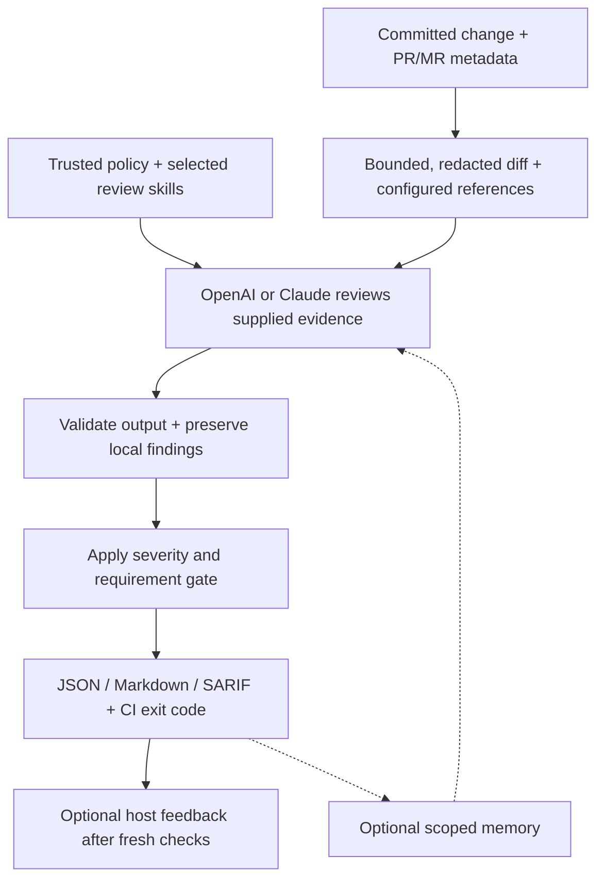

<div align="center">
    <a href="https://businessharness.net/">
        
    </a>
</div>

<h1 align="center">BusinessHarness</h1>

<p align="center"><strong>Put every change in context.</strong></p>

<p align="center">
    Bounded AI diff review, reference validation, and optional review memory for your CI pipeline.
</p>

<div align="center">

[](https://github.com/jihadkhawaja/BusinessHarness/actions/workflows/ci.yml)
[](https://www.nuget.org/packages/BusinessHarness)
[](https://www.nuget.org/packages/BusinessHarness)
[](SECURITY.md)
[](https://dotnet.microsoft.com/download/dotnet/10.0)
[](LICENSE)

</div>

Review code changes, check them against tickets and specs, and catch potential issues before merging. BusinessHarness is a .NET 10 CLI that runs locally or in GitHub Actions, GitLab CI, Azure DevOps, and Bitbucket Pipelines.

- **Unified experience across all pipelines** — the same CLI commands, review policy, report formats, and exit codes across GitHub Actions, GitLab CI, Azure DevOps, and Bitbucket Pipelines.
- **AI reviews** with OpenAI or Claude, plus an offline credential-pattern scan.
- **Ticket and spec checks** using Jira Cloud or configured JSON APIs.
- **Configurable review skills** from a trusted bank, enabled per pipeline or PR review.
- **Optional feedback and memory** for PR/MR comments, approvals, and follow-up reviews.
- **Reports you can use** in JSON, Markdown, and SARIF.

## Storyboard: from change to review decision

A diff shows what changed. A ticket explains what the change needs to achieve.
BusinessHarness brings that evidence together so reviewers can spot gaps before
merging and CI can enforce a configured review gate.

**Illustrative story:** a team is adding a CSV export. Ticket `PROJ-123` requires
timestamps to retain microsecond precision, but an added formatting line keeps
only whole seconds. This example describes a possible review, not an actual run
or a guarantee that the model will find every issue.

| Scene | What happens | How it helps |
| --- | --- | --- |
| **1. Open the change** | A developer opens a PR/MR and includes `PROJ-123` in its title or description. The team has configured Jira and trusted review policy. | The review can consider the intended behavior alongside the code. |
| **2. Prepare the evidence** | BusinessHarness resolves the commits, builds a bounded diff, withholds sensitive paths, redacts detected credentials, and fetches the ticket through configured routing. | The provider receives selected change context and requirements without access to the checkout or host write credentials. |
| **3. Compare code with intent** | OpenAI or Claude reviews the supplied evidence and may flag the added timestamp formatting line for losing precision. | A requirement gap becomes a concrete finding anchored to an added line. |
| **4. Validate and apply the gate** | BusinessHarness validates the response and finding locations, retains local security findings, and checks reference coverage against policy. | CI gets a failing result for findings at or above the configured severity threshold or failed requirement assessments. Missing, partial, or unverifiable assessments also fail the gate. |
| **5. Fix and rerun** | The developer preserves timestamp precision and runs a new review of the updated commits. JSON, Markdown, and SARIF reports capture the result. | Reviewers get current evidence for their merge decision. Comments or eligible automatic approvals require explicitly enabled feedback and fresh host checks. |
| **6. Carry context forward, if enabled** | Opt-in memory stores a compact validated outcome outside the reviewed checkout and recalls relevant history in later reviews. | Follow-up reviews can retain context; historical memory cannot prove current correctness or authorize approval. |



Choose **`scan`** for an offline credential-pattern check of added lines; it makes
no provider, host, or reference calls and does not use memory. Choose **`review`**
to compare the diff with configured ticket/spec evidence through a provider API.
The model sees the diff and three lines of context, cannot read whole files or
run tests, and may leave runtime requirements unverifiable. Keep human review,
tests, and dedicated security checks in your workflow. See the
[security model](SECURITY.md), [gate and feedback settings](docs/configuration.md),
and [exit codes](docs/errors.md).

## Quick start

Requires .NET 10 and Git. Install the latest stable release:

```powershell
dotnet tool install --global BusinessHarness
businessharness --help
```

Already installed? Update with `dotnet tool update --global BusinessHarness`.
For reproducible CI runs, pin a reviewed version with `--version`.

Scan a repository without credentials or network requests:

```powershell
businessharness scan --repo C:/code/my-project --base origin/main --head HEAD
```

The scan compares committed changes from the common ancestor of the two refs to `HEAD`. Both refs and their shared history must be available locally; uncommitted changes are ignored.

PR reviews cover additions, modifications, and deletions across all PR commits.
Both providers receive the same bounded diff and linked ticket/specification
evidence. Unseen code and runtime behavior cannot establish a passing assessment.

For an AI review, supply `OPENAI_API_KEY` through your shell environment or CI secret store, then choose a model with structured output support:

```powershell
$env:HARNESS_PROVIDER = 'openai'
$env:HARNESS_MODEL = 'YOUR_STRUCTURED_OUTPUT_MODEL'
businessharness validate
businessharness review --repo C:/code/my-project --base origin/main --head HEAD
```

For Claude, use `HARNESS_PROVIDER=anthropic` and `ANTHROPIC_API_KEY`. Both providers use their APIs and require API credentials.

Results are saved to `harness-results` by default. Host feedback is off unless you enable it. See [configuration](docs/configuration.md) for references, feedback permissions, and review settings.

Customize PR/MR review comments with `--comment-template PATH` or trusted policy.
Start from the [default template](src/BusinessHarness.Infrastructure/Templates/review-comment.md) and follow the
[template configuration guide](docs/configuration.md#review-comment-templates).

Define reusable review guidance in a trusted [skills bank](examples/harness.skills.policy.json)
and select it per review with `--skills dotnet,api-security` or the GitHub Action's
`skills` input. Agents apply relevant enabled skills on demand; see
[review skills](docs/configuration.md#review-skills-bank).

## Use in CI

Start with an example for your platform:

[GitHub Actions](examples/pipelines/github.yml) · [GitLab CI](examples/pipelines/gitlab.yml) · [Azure DevOps](examples/pipelines/azure-devops.yml) · [Bitbucket Pipelines](examples/pipelines/bitbucket.yml)

Replace the marked action/image placeholders and configure your CI secrets before running. See the [integration guide](docs/integrations.md) for setup, containers, and publishing.

This repository has [automatic PR reviews](.github/workflows/pr-review.yml) and
[maintainer-triggered review comments](.github/workflows/review.yml). See
[automatic review setup](docs/integrations.md#this-repositorys-automatic-pr-review)
and [mention testing](docs/integrations.md#test-reviews-in-this-repository).

Use the [BusinessHarness GitHub App](docs/github-app.md) for a dedicated bot
identity and concise findings in the PR Conversation tab, focused on security,
maintainability, correctness, and available specifications.

## Learn more

- [Configuration](docs/configuration.md) — providers, tickets, specs, and feedback.
- [Memory](docs/memory.md) — opt-in review history and follow-ups.
- [Errors and recovery](docs/errors.md) — exit codes and troubleshooting.
- [Security](SECURITY.md) and [architecture](docs/architecture.md) — how reviews are bounded and protected.

## Contribute

Use the SDK selected by [global.json](global.json), Git, and PowerShell 7. From the repository root:

```powershell
git submodule update --init --recursive
./scripts/Verify.ps1
./scripts/Smoke-Test.ps1
```

See [AGENTS.md](AGENTS.md) for contributor guidance and [docs/codex.md](docs/codex.md) for Codex review agents.

## License

Copyright (c) 2026 **Jihad Khawaja**.

See [LICENSE](LICENSE) for usage and commercial licensing terms, including the employer exception,
and [third-party notices](THIRD-PARTY-NOTICES.md) for dependency licenses.
