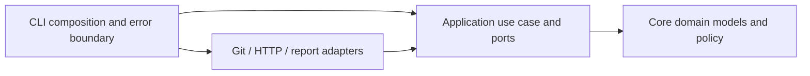

# Architecture

Trusted policy can define a bounded `skillBank` and `enabledSkills`. Invocation
`--skills` overrides the enabled names. The provider contract redacts and inserts
only selected skill guidance into system instructions; the model chooses relevant
guidance by description within its single review call. Skills add no tools or file
access and remain subordinate to the shared review rules. Skills are never loaded
from reviewed repository content. See [skills configuration](configuration.md#review-skills-bank).

Dependencies point inward:

| Project | Responsibility |
| --- | --- |
| BusinessHarness.Core | Domain records, severity policy, error taxonomy; no project dependencies |
| BusinessHarness.Application | Review use case, result validation, IChangeSource/IReviewProvider/IReferenceResolver/IChangeRequestHost/IIssueSource/IReportWriter/IReviewMemory |
| BusinessHarness.Infrastructure | Git subprocess isolation, redaction, provider REST adapters, Jira ADF conversion, configured JSON reference routing, GitHub/GitLab metadata and feedback, report persistence |
| BusinessHarness.Cli | Explicit option/config binding, manual dependency injection, cancellation, safe diagnostics, process exit |
| BusinessHarness.Tests | Application, architecture, security, HTTP-contract, CLI and real temporary-Git tests |

The composition root constructs long-lived HTTP resources for one invocation and passes them through interfaces. Application code depends on abstractions, not HTTP or Git implementations. `TimeProvider` makes time an explicit dependency. All I/O is async where supported, accepts cancellation, and owns/disposes its resources. Nullable annotations, strict JSON binding, current analyzers, deterministic builds, warnings-as-errors, lock files and centralized package versions apply repository-wide.

Flow: validate trusted policy → identify PR/MR and fetch metadata → resolve host base and local source head → build bounded diff → withhold sensitive paths → detect/redact possible secrets → discover and resolve references → recall bounded scoped history → call one provider → validate output and complete reference coverage → apply gate → write sanitized reports → remember validated review outcome → optionally recheck request and publish feedback.

Add a provider by implementing `IReviewProvider` in Infrastructure and registering it in the composition root. It must return the shared `ReviewResult`; application validation and local security findings still apply. Add GET JSON sources through trusted `referenceSources` policy, or implement `IReferenceResolver` for other protocols. `IIssueSource` supports the native Jira adapter. Add code hosts through `IChangeRequestHost`. Providers receive source-neutral `ReferenceDocument` records. Add other automation use cases in Application rather than embedding CI-vendor or network logic in domain types. Reference routing and review feedback run through typed adapters; repository text never supplies shell commands.

Current review scope is the diff and its three lines of context. The model cannot read whole files, execute tests or mutate the repository. The harness resolves references from PR/MR metadata through configured routes before provider invocation; it does not grant the model unrestricted browsing or shell tools. Findings reference actual added lines. Reference assessments remain model judgments about supplied evidence; runtime criteria can be not_verifiable. Optional feedback uses host adapters after report validation, with a fresh metadata check and commit-bound approval. GitLab failure feedback removes only the bot’s own approval; CI remains the blocking gate.

Long-term memory is exposed through `IReviewMemory`. Infrastructure builds MAGICore from the pinned `external/MAGICore` submodule and persists its memory records in locked, atomically replaced scope snapshots. Core/Application have no MAGICore dependency. The CLI resolves trusted global/repository/invocation settings and consumes verified follow-up events. Historical context remains separate from current reference assessments. See [memory](memory.md).
