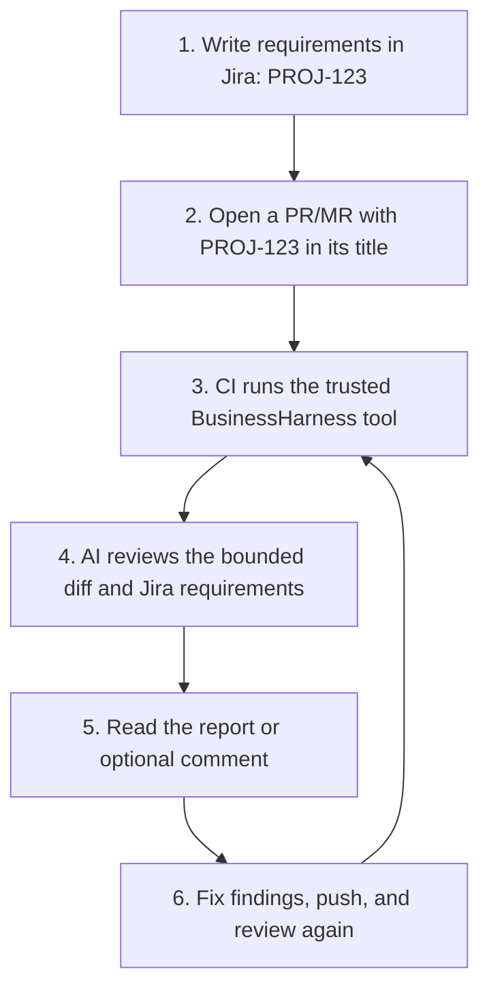
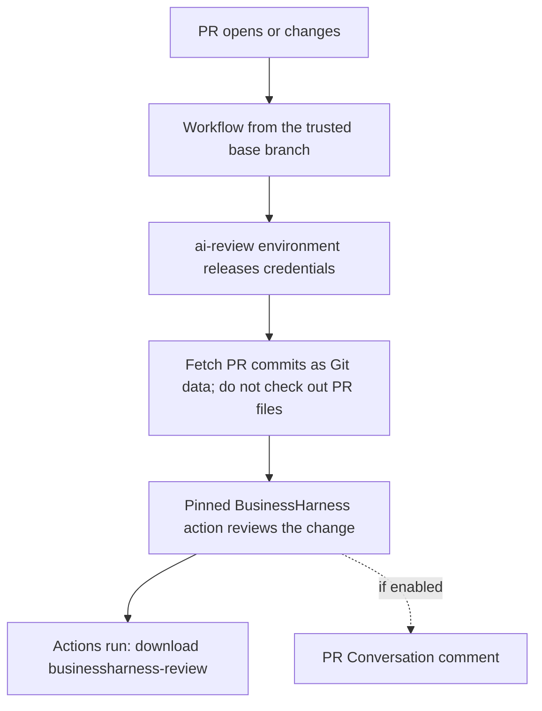
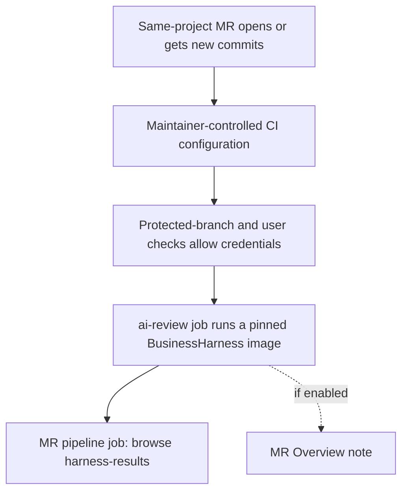

# Your first PR/MR review with Jira

This guide takes you from a Jira ticket to a BusinessHarness review in GitHub
Actions or GitLab CI. Complete the shared setup, then follow **one** platform.
The result is a downloadable review report, with an optional PR/MR comment.

**One-time setup:** a repository maintainer configures the pipeline and secrets.
After that, developers add a Jira key to a PR/MR and read the review.
PR means GitHub pull request; MR means GitLab merge request. CI is the automated
pipeline that runs when you propose a change. This guide adds a review step to CI;
it does not deploy your application.

1. [Prepare Jira](#1-prepare-a-jira-ticket-and-credentials).
2. Follow [GitHub Actions](#2a-set-up-github-actions) **or** [GitLab CI](#2b-set-up-gitlab-ci).
3. [Read the review and rerun](#3-read-the-review-and-rerun).



The examples use OpenAI. For Claude, set `HARNESS_PROVIDER` to `anthropic` and
store `ANTHROPIC_API_KEY` instead of `OPENAI_API_KEY`. Both require API credentials.
Ask your team which structured-output model and source-code data sharing are
approved. Reviews send selected code context and ticket text to that provider.
BusinessHarness reviews committed differences; it does not run your code or tests.

## 1. Prepare a Jira ticket and credentials

### Create a small test ticket

In Jira Cloud, create a ticket and note its actual key, such as `PROJ-123`.
Put clear requirements in the **description**, for example:

```text
Summary: Preserve timestamp precision in CSV exports

Acceptance criteria:
- Exported timestamps retain all six microsecond digits.
- Existing CSV column names stay the same.
```

Start with requirements in the description. A separate custom acceptance-criteria
field is optional and needs [additional configuration](configuration.md).
Attachments are not fetched. Use a small code change relevant to the ticket for
your first review; runtime requirements may remain unverifiable from a diff alone.

### Create the Jira credentials

1. Ask your Jira administrator for a dedicated Atlassian user account for automation, with permission
   to browse the relevant project and see the test ticket, including any issue
   security restrictions. It does not need permission to edit tickets.
2. Sign in as that account and follow Atlassian's
   [API token instructions](https://support.atlassian.com/atlassian-account/docs/manage-api-tokens-for-your-atlassian-account/).
   The current native adapter uses email + API token with Basic authentication
   against `https://YOUR_TEAM.atlassian.net/rest/api/3/...`.
   Choose a token **without scopes** for this tenant endpoint, if your organization
   permits it. Scoped tokens use the `api.atlassian.com` gateway, which the native
   adapter does not support. If scoped tokens are required, ask your maintainer
   about a trusted [JSON reference gateway](configuration.md#dynamic-reference-sources).
3. Save the account email and token directly in your platform's secret store in
   the steps below. Set an expiry and arrange rotation. Do not commit them.

See [Atlassian's Basic authentication guide](https://developer.atlassian.com/cloud/jira/platform/basic-auth-for-rest-apis/).
The native adapter supports Jira Cloud tenants on `atlassian.net`; Jira Data Center
and custom Jira hostnames need a different integration.

You will configure these names on either platform:

| Name | Example or purpose | Store as |
| --- | --- | --- |
| `HARNESS_PROVIDER` | `openai` | Variable |
| `HARNESS_MODEL` | Your approved API model ID with structured output support | Variable |
| `HARNESS_JIRA_SITE` | `https://YOUR_TEAM.atlassian.net` (no `/browse` path) | Variable |
| `OPENAI_API_KEY` | Provider API credential | Secret |
| `JIRA_EMAIL` | Jira automation account email | Secret |
| `JIRA_API_TOKEN` | Token created by that same account | Secret |

**Checkpoint:** the automation account can open the ticket in Jira. This confirms
visibility; the first CI review will also check API authentication.

## 2A. Set up GitHub Actions

Use this path for a repository on **github.com**. You need repository settings
access and an Ubuntu GitHub-hosted runner.



### Create the review environment

1. Open **Repository → Settings → Environments → New environment** and name it
   `ai-review`.
2. Restrict its deployment branches to your trusted target branch, such as `main`.
   Add required reviewers if your plan supports them. See
   [GitHub environment setup and availability](https://docs.github.com/en/actions/how-tos/deploy/configure-and-manage-deployments/manage-environments).
3. Inside this environment, add the three variables and three secrets from the
   table above. Keep these secrets out of repository-wide and organization-wide
   scopes that expose them to PR branch workflows.

### Add the workflow

1. Copy the complete [GitHub workflow example](../examples/pipelines/github.yml)
   into **your application repository** as `.github/workflows/review.yml`.
2. Replace `YOUR_ORG/BusinessHarness@FULL_COMMIT_SHA` with the accessible
   BusinessHarness action repository and a reviewed **full commit SHA**. For the
   upstream repository, the form is:

   ```yaml
   uses: jihadkhawaja/BusinessHarness@FULL_COMMIT_SHA
   ```

   Replace the placeholder before running. For a private action, a maintainer must
   configure sharing and pass a `github-token` that can read the action source as
   well as the application's PR metadata; the action fetches its own Git source.
   The caller's default token cannot normally read a separate private repository.
3. Keep `feedback: none` and the existing read permissions for the first run.
   The action installs .NET and builds its own pinned source; you do not need to
   add application build steps to this review job.
4. Have a maintainer review and merge the workflow into `main` before testing a
   new PR against it. Protect later workflow and policy changes with owner review.

**Why this workflow?** It uses `pull_request_target`, so its executable workflow
and checkout come from the trusted base. PR commits are fetched only for diff
inspection. Preserve `ref: ${{ github.workflow_sha }}` and
`persist-credentials: false`; never add a PR-head checkout or run PR scripts in
this secret-bearing job. See [GitHub's workflow security guidance](https://docs.github.com/en/actions/reference/security/secure-use).

### Try it and find the report

1. Create a branch, commit a small change, and open a PR targeting `main` with a
   title such as `PROJ-123: preserve CSV timestamp precision`.
2. Go to **Actions → BusinessHarness review**, open the new run, and approve the
   environment job if your setup requires it.
3. When it finishes, download the **businessharness-review** artifact from the
   run summary. Open `review.md` first. A failed run can still have useful reports.

The example runs on PR creation, source pushes, reopening, title/description
edits, and readiness for review. Fork PRs can be inspected through this trusted
base workflow; their own workflows must not receive the review secrets.

### Optional: show the result on the PR

Once reports work, change these two entries in the copied workflow:

```yaml
permissions:
  contents: read
  pull-requests: write
```

In the BusinessHarness action's `with:` block, set:

```yaml
feedback: comment
```

The next completed review posts to the PR **Conversation** tab. Leave automatic
approval for a later rollout; [feedback modes](configuration.md#pullmerge-request-metadata-and-feedback)
explain the permissions and safeguards. A [GitHub App](github-app.md) is optional
if you want a dedicated bot identity.

**Merge protection:** this starter's `pull_request_target` run is associated with
the base-branch context, not a separate check on the PR source SHA. Its failure
does not by itself block merging. Keep normal build/test checks required through
[branch protection](https://docs.github.com/en/repositories/configuring-branches-and-merges-in-your-repository/managing-protected-branches/about-protected-branches).
To make this AI review a required PR-head gate, a maintainer must add a trusted
status/check publisher bound to the reviewed source SHA; that publisher is not
included in the starter. Until then, treat the report/comment as review evidence.

Continue to [your first review](#3-read-the-review-and-rerun).

## 2B. Set up GitLab CI

Use this path for a project on **gitlab.com**. You need a Maintainer, a container
runner, and a trusted BusinessHarness container image. Self-managed GitLab also
needs explicit [host configuration](configuration.md#pullmerge-request-metadata-and-feedback).



### Prepare the trusted runner configuration

1. Ask your maintainer for a BusinessHarness image published by your team and
   pinned as `YOUR_REGISTRY/businessharness@sha256:YOUR_DIGEST`. There is no assumed
   public image. Maintainers can follow [container build and publishing setup](integrations.md#local-packaging-and-containers)
   from a trusted release checkout; do not build the review tool from the MR.
   Configure registry pull access if the image is private.
2. Create a separate, maintainer-controlled GitLab project for CI configuration,
   for example `YOUR_GROUP/review-ci`, with a protected default branch.
   Copy the [GitLab job example](../examples/pipelines/gitlab.yml) into that
   project's root as `businessharness.yml`. People running pipelines need read
   access to that project; only trusted maintainers should change its files.
3. In your **application project**, open **Settings → CI/CD → General pipelines**.
   Set **CI/CD configuration file** to
   `businessharness.yml@YOUR_GROUP/review-ci`. Replace the group/project names.
   This makes the root pipeline configuration independent of MR edits. See
   [GitLab's custom configuration instructions](https://docs.gitlab.com/ci/pipelines/settings/#specify-a-custom-cicd-configuration-file).

This setting replaces the application's usual root pipeline configuration.
Have the maintainer preserve existing build/test jobs in trusted configuration,
in separate jobs without review credentials. A branch-local `include` alone does
not protect the root pipeline from MR edits. Do not run application scripts,
tests, builds, or MR-supplied configuration in the review job.

In the copied `businessharness` job, add this environment alongside `image:`,
`variables:`, and `script:`:

```yaml
environment:
  name: ai-review
  action: verify
```

`verify` lets this job use the named environment without creating a deployment;
see [GitLab's environment actions](https://docs.gitlab.com/ci/yaml/#environmentaction).

### Add variables and allow protected MR access

1. In the application project, open **Settings → CI/CD → Variables**. Add
   `HARNESS_IMAGE` with the pinned image reference; it is not a secret and can
   use environment scope `*`. Keep image selection maintainer-controlled.
2. Add the shared Jira/provider settings from step 1. Use environment scope
   **ai-review** for all six, and mark the secrets **Protected** and **Masked**
   (and hidden if available). Use the default `Variable` type, not `File`.
   Leave variable-reference expansion off for secrets. This keeps credentials
   out of ordinary build/test jobs. See [GitLab CI/CD variables](https://docs.gitlab.com/ci/variables/).
3. Create a token for a dedicated bot that can read this project's MR metadata,
   using `read_api` scope, and save it as `GITLAB_TOKEN` with the same protected,
   masked, `ai-review` scope. A
   [project access token](https://docs.gitlab.com/user/project/settings/project_access_tokens/)
   can be used where available. `CI_JOB_TOKEN` is not a substitute here.
4. Ask the maintainer to protect both `main` and the source branches used for
   these reviews, such as `review/*`, and set appropriate push/merge permissions.
   Under **Settings → CI/CD → Variables → Access protected resources in merge
   request pipelines**, enable access for eligible MR pipelines.

**Important checkpoint:** protected credentials require source and target branches
in the same project, both protected, and a triggering user with push/merge access
to the target. These rules and the access setting are documented in
[GitLab's protected MR resource requirements](https://docs.gitlab.com/ci/pipelines/merge_request_pipelines/#control-access-to-protected-variables-and-runners).
Ask a maintainer to run the first test if your role is ineligible. Ordinary
unprotected feature branches will not receive these secrets. Fork MRs are
excluded by the starter's job rules. Keep those protections; use a separate
credential-free scan for contributions outside this setup.

### Try it and find the report

1. Have an authorized contributor push a small committed change to a protected
   source branch such as `review/PROJ-123`. Open an MR into protected `main`, with
   `PROJ-123` in the title or description.
2. Open the MR's **Pipelines** tab and select the **businessharness** job.
3. Browse or download its artifacts and open `harness-results/review.md`.
   Reports are kept for seven days, including on failed runs.

New commits trigger another review. If you only edit the MR title/description or
Jira requirements, select **Run pipeline** from the MR's Pipelines tab to fetch
the current evidence. The example keeps the actual source SHA for both detached
and merged-result pipelines; preserve its `--base` and `--head` arguments.

### Optional: comments and a blocking pipeline

For an MR note, use an eligible bot token with **api** scope instead of `read_api`,
and add `--feedback comment` to the folded review command in `script:`. The next
completed review publishes to the MR **Overview**. Keep `allow_failure: false`.

To block merging on a failed review, open **Settings → Merge requests → Merge
checks**, enable **Pipelines must succeed**, and leave **Skipped pipelines are
considered successful** off. Confirm the latest MR pipeline contains the review
job; a skipped/absent review is not evidence of a pass. See
[GitLab's merge-check setup](https://docs.gitlab.com/user/project/merge_requests/auto_merge/#require-a-successful-pipeline-for-merge).
Keep build/test jobs and human review in your merge process too.

## 3. Read the review and rerun

In either platform, begin with `review.md`:

| What to look for | What it tells you |
| --- | --- |
| Findings | Potential security, correctness, or maintainability issues anchored to added lines |
| Specifications | Whether the diff supplies evidence for your Jira requirements |
| Review scope | Compared commits, inspected/withheld files, and the gate result |
| `error.json`, if review could not finish | A structured error and recovery hint |

For the CSV example, a report **might** flag lost timestamp precision. This is an
illustration, not a guaranteed finding. Confirm the real ticket key appears in
the specifications section. **No linked specifications supplied** means Jira
coverage was not assessed; a passing code-only review is not proof of ticket
coverage. Keys are discovered from the PR/MR **title and description**, not just
the branch name or commit messages.

| Exit code | Meaning | Next step |
| --- | --- | --- |
| `0` | Review completed and its configured gate passed | Read the evidence and continue normal review |
| `1` | Review completed but findings or requirement assessments failed the gate | Inspect, fix, and push another commit |
| `2`–`10` | Setup, Git, API, response, or other operational error | Read `error.json` and [error recovery](errors.md) |

By default, high/critical findings fail the gate; lower-severity findings can
coexist with a pass. Missing, partial, or unverifiable reference assessments fail
the gate. Fix the change or supply the missing evidence rather than treating an
incomplete review as successful. The model sees a bounded diff and nearby lines,
so it cannot prove every runtime requirement. Keep tests and human review.

**First-run checklist:**

- [ ] CI runs for the intended PR/MR and uses the current source commit.
- [ ] `review.md` contains the real Jira key and a specification assessment.
- [ ] Reports can be downloaded even when the review fails.
- [ ] Pushing a new commit produces a fresh review.
- [ ] If enabled, the PR comment/MR note appears without automatic approval.
- [ ] Merge protection behaves as described for your platform.

## Common first-run problems

| Symptom | What to check |
| --- | --- |
| Workflow/job never starts | GitHub: workflow merged into the trusted target branch. GitLab: custom config is readable and the MR matches the same-project rule. Check runner availability. |
| Missing model or API key (`BH1002`) | Exact variable names, selected provider, GitHub environment approval, or GitLab protected-resource eligibility and `ai-review` environment scope. |
| Jira returns 401/403 (`BH1004`) | Email/token belong to the same account, token is current and supports the tenant endpoint, and account can view the ticket. |
| No Jira assessment | Set `HARNESS_JIRA_SITE` and include the actual key in the PR/MR title or description, then rerun. Branch/commit naming alone is insufficient. |
| Missing commits or stale source (`BH1003`/host validation error) | Preserve full-history fetching and source-SHA selection from the examples. Start a fresh review of the current commits. |
| No comment appears | Feedback defaults to `none`. Check `comment`, host token permissions, and whether the review finished; changed metadata can withhold publication. |
| Provider/network failure (`BH1005`) | Model access, quota, approved egress and service availability. Rerun only after checking the cause; provider calls can incur charges. |

Reports can contain business context. Limit artifact access and retention; never
paste credentials or raw private reports into public issues. For all bounds,
permissions, and failure behavior, see [configuration](configuration.md),
[integrations](integrations.md), and the [security model](../SECURITY.md).

## Optional: see development activity inside Jira

BusinessHarness only needs the Jira API credentials above to read requirements.
If you also want branches, commits, and PRs/MRs displayed in Jira's development
panel, follow the separate [GitHub for Atlassian setup](https://support.atlassian.com/jira-cloud-administration/docs/integrate-jira-software-with-github/)
or [GitLab for Jira Cloud setup](https://docs.gitlab.com/integration/jira/connect-app/).
Those apps do not configure BusinessHarness secrets or enable its review jobs.
